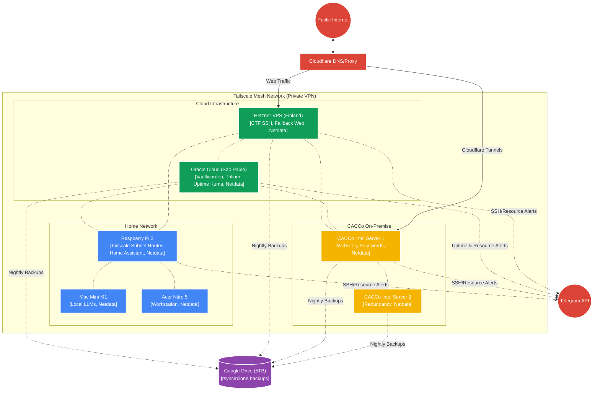

# Network Topology

The infrastructure will be tied together using **Tailscale** to create a secure, flat mesh network. This allows all servers and devices to communicate securely without exposing internal services directly to the public internet. Public-facing services will be routed through Cloudflare or specific reverse proxies.

## Topology Notes:
1.  **Tailscale Mesh:** Every node sits on the Tailscale network. You can access the Trilium server on Oracle Cloud directly from your Acer Nitro 5 via its Tailscale IP (e.g., `100.x.y.z`), without exposing Trilium to the public internet.
2.  **Raspberry Pi as Subnet Router:** If you need to access smart home devices or other non-Tailscale devices on your home network while away, the RPi can advertise your home subnet to Tailscale. It's lightweight enough to handle VPN routing without sweating.
3.  **Public Exposure:** Cloudflare proxies traffic for your domains (`leazirondi.com.br`, `cacco.com.br`) and forwards it only to the specific servers hosting public services (e.g., websites). You can use **Cloudflare Tunnels** (`cloudflared`) on the CACCo servers so you don't even need to open inbound ports on the college firewall. The Hetzner box will have port 22 (or a custom port) open specifically for the CTF SSH server.
