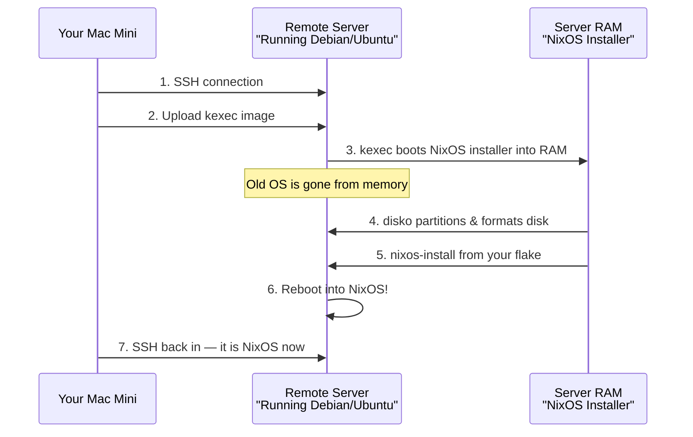

# Installing NixOS on a Remote Server via RAM (nixos-anywhere)

This is the method for converting a remote server running **any Linux distro** (Debian, Ubuntu, etc.) into a fully declarative NixOS machine — **without physical access, without a bootable ISO, and without a KVM console**. It works by loading a NixOS installer kernel directly into RAM using `kexec`.

## How It Works



> [!CAUTION]
> This process **completely wipes the target server's disk**. All existing data will be destroyed. This is intended for fresh servers or servers you want to repurpose.

## Prerequisites

| Requirement | Details |
|---|---|
| **Local machine** | Nix installed with Flakes enabled (your Mac Mini ✅) |
| **Remote server** | Any running Linux with SSH + root access |
| **RAM** | At least **1.5 GB free** on the server (Hetzner 4GB ✅, Oracle 16GB ✅) |
| **Architecture** | x86_64 or aarch64 |
| **SSH key** | Your key must be accessible locally (`~/.ssh/main`) |

---

## Step 1: Add `disko` to Your Flake

`disko` is the declarative disk partitioning tool that `nixos-anywhere` uses to format your server's drives automatically.

Add it to your `flake.nix` inputs:

```nix
# In your inputs section, add:
disko = {
  url = "github:nix-community/disko";
  inputs.nixpkgs.follows = "nixpkgs";
};
```

Then make it available in your outputs:

```nix
outputs = { self, nixpkgs, nix-darwin, home-manager, nixos-hardware, disko, ... }:
```

---

## Step 2: Create the Disk Configuration

Create a disko config for your server. This example is for the **Hetzner VPS** (single disk, GPT, ext4):

### `hosts/<hostname>/disk-config.nix`

```nix
# Declarative disk layout for nixos-anywhere / disko
# Adjust /dev/sda to match your server's disk (check with `lsblk`)
{
  disko.devices = {
    disk.main = {
      device = "/dev/sda";  # Hetzner VPS typically uses /dev/sda
      type = "disk";
      content = {
        type = "gpt";
        partitions = {
          # BIOS boot partition (needed for GRUB on legacy BIOS servers)
          boot = {
            size = "1M";
            type = "EF02";  # BIOS boot partition
          };
          # EFI System Partition (needed for UEFI servers)
          ESP = {
            size = "512M";
            type = "EF00";
            content = {
              type = "filesystem";
              format = "vfat";
              mountpoint = "/boot";
            };
          };
          # Root partition — takes all remaining space
          root = {
            size = "100%";
            content = {
              type = "filesystem";
              format = "ext4";
              mountpoint = "/";
            };
          };
        };
      };
    };
  };
}
```

> [!TIP]
> **How to find the disk device name:** SSH into the server *before* running nixos-anywhere and check with `lsblk` or `fdisk -l`. Hetzner VPS usually uses `/dev/sda`. Oracle Cloud ARM instances often use `/dev/sda` or `/dev/vda`.

> [!NOTE]
> This config includes **both** a BIOS boot partition and an EFI partition. This is safe — the unused one simply takes up 1M–512M of space. If you know your server is purely UEFI, you can remove the `boot` (BIOS) partition. If purely legacy BIOS, you can remove the `ESP` partition.

---

## Step 3: Create the Server's NixOS Configuration

### `hosts/<hostname>/default.nix` (example for Hetzner)

```nix
{ config, pkgs, lib, ... }:

{
  imports = [
    ./disk-config.nix  # disko handles hardware/filesystem config
  ];

  # ── Boot ──
  boot.loader.grub = {
    enable = true;
    efiSupport = true;
    efiInstallAsRemovable = true;  # Safe for cloud VPS without NVRAM
  };

  # ── Networking ──
  networking.hostName = "hetzner";

  # IMPORTANT: Enable DHCP so you don't lose connectivity after install
  networking.useDHCP = lib.mkDefault true;

  # ── SSH Access (CRITICAL — lock yourself out without this!) ──
  services.openssh = {
    enable = true;
    settings = {
      PermitRootLogin = "prohibit-password";
      PasswordAuthentication = false;
    };
  };

  # Your SSH public key — without this you CANNOT access the server after install!
  users.users.root.openssh.authorizedKeys.keys = [
    "ssh-ed25519 AAAAC3NzaC1lZDI1NTE5AAAAIDLUEF3D+nMwdt087Dks62tm7ftrAPv4/pMJi073oLxt"
  ];

  # ── Your regular user ──
  users.users.zirondi = {
    isNormalUser = true;
    extraGroups = [ "wheel" "docker" ];
    openssh.authorizedKeys.keys = [
      "ssh-ed25519 AAAAC3NzaC1lZDI1NTE5AAAAIDLUEF3D+nMwdt087Dks62tm7ftrAPv4/pMJi073oLxt"
    ];
  };

  # ── Basic packages ──
  environment.systemPackages = with pkgs; [
    vim
    git
    htop
    tmux
  ];

  # ── Firewall ──
  networking.firewall = {
    enable = true;
    allowedTCPPorts = [ 22 ];  # SSH only; add more as needed
  };

  system.stateVersion = "26.05";
}
```

> [!WARNING]
> **The SSH key is the most critical part.** If you forget to add your public key, you will be permanently locked out of the server after nixos-anywhere finishes. There is no password fallback. Double-check the key matches your `~/.ssh/main.pub`.

---

## Step 4: Wire It Into Your Flake

Add the new host to your `flake.nix`:

```nix
nixosConfigurations = {
  # ... existing hosts (nitro5, rpi3, etc.) ...

  # --- Hetzner VPS (Finland, x86_64) ---
  hetzner = nixpkgs.lib.nixosSystem {
    system = "x86_64-linux";
    modules = [
      # Host-specific config (includes disk-config.nix)
      ./hosts/hetzner/default.nix

      # Shared modules
      ./modules/shared/common.nix
      ./modules/shared/cli-tools.nix
      ./modules/nixos/common.nix

      # disko module
      disko.nixosModules.disko

      # Home Manager
      home-manager.nixosModules.home-manager
      {
        home-manager.useGlobalPkgs = true;
        home-manager.useUserPackages = true;
        home-manager.users.zirondi = import ./modules/shared/home.nix;
      }
    ];
  };
};
```

> [!NOTE]
> This example doesn't use `mkNixosHost` because we need to add `disko.nixosModules.disko` to the modules. You could also modify `mkNixosHost` to accept disko, but keeping it explicit is clearer for a first deployment.

---

## Step 5: Run nixos-anywhere

From your Mac Mini, run:

```bash
# Run nixos-anywhere — use absolute paths and offload the build to the remote server!
nix run github:nix-community/nixos-anywhere -- \
  --flake '/Users/zirondi/repos/github/me/public/dotfiles#hetzner' \
  --build-on remote \
  root@<SERVER_IP>
```

### What happens behind the scenes

1. **SSH** — connects to the server using your key
2. **Upload kexec** — sends the NixOS installer kernel + initrd to the server
3. **kexec** — the server jumps into the NixOS installer running entirely in RAM (the old OS is gone)
4. **SSH reconnect** — nixos-anywhere waits for the RAM-based installer to come back online
5. **disko** — partitions and formats `/dev/sda` according to your `disk-config.nix`
6. **nixos-install** — installs your full NixOS configuration from the flake
7. **Reboot** — the server reboots into your fresh NixOS installation

### Common flags

```bash
# If you need to specify a different SSH key:
nix run github:nix-community/nixos-anywhere -- \
  --flake '.#hetzner' \
  -i ~/.ssh/main \
  root@<SERVER_IP>

# If the server uses password auth (no SSH key yet):
SSHPASS='your-password' nix run github:nix-community/nixos-anywhere -- \
  --flake '.#hetzner' \
  --env-password \
  root@<SERVER_IP>

# Build on the remote server instead of locally (useful from ARM Mac → x86 server):
nix run github:nix-community/nixos-anywhere -- \
  --flake '.#hetzner' \
  --build-on remote \
  root@<SERVER_IP>
```

> [!TIP]
> Since your Mac Mini is `aarch64-darwin` and the Hetzner VPS is `x86_64-linux`, use `--build-on remote` to avoid cross-compilation issues. This tells nixos-anywhere to build the NixOS closure on the server itself instead of on your Mac.

> [!NOTE]
> During the installation, if you see `Warning: Identity file /tmp/.../nixos-anywhere not accessible: No such file or directory`, you can safely ignore it. This is a known harmless warning that happens when `nixos-anywhere` reconnects to the server after `kexec` because the temporary SSH keys it uses are cleaned up. It will seamlessly fall back to your standard SSH keys.

---

## Step 6: Verify and Post-Install

After the process completes (~5-15 minutes depending on server speed):

```bash
# SSH into your fresh NixOS server
ssh root@<SERVER_IP>

# Verify it's NixOS
cat /etc/os-release

# Check your configuration applied
systemctl status sshd

# Set up Tailscale (if configured in your modules)
sudo tailscale up
```

---

## Adapting for Oracle Cloud ARM

For the Oracle Cloud free tier (aarch64), create a separate host:

```nix
# In flake.nix
oracle = nixpkgs.lib.nixosSystem {
  system = "aarch64-linux";  # ARM!
  modules = [
    ./hosts/oracle/default.nix
    ./modules/shared/common.nix
    ./modules/shared/cli-tools.nix
    ./modules/nixos/common.nix
    disko.nixosModules.disko
    home-manager.nixosModules.home-manager
    {
      home-manager.useGlobalPkgs = true;
      home-manager.useUserPackages = true;
      home-manager.users.zirondi = import ./modules/shared/home.nix;
    }
  ];
};
```

The `disk-config.nix` for Oracle usually uses `/dev/sda` and only needs the EFI partition (Oracle is UEFI-only):

```nix
{
  disko.devices = {
    disk.main = {
      device = "/dev/sda";
      type = "disk";
      content = {
        type = "gpt";
        partitions = {
          ESP = {
            size = "512M";
            type = "EF00";
            content = {
              type = "filesystem";
              format = "vfat";
              mountpoint = "/boot";
            };
          };
          root = {
            size = "100%";
            content = {
              type = "filesystem";
              format = "ext4";
              mountpoint = "/";
            };
          };
        };
      };
    };
  };
}
```

---

## Updating After Install

Once installed, you manage the server like any other NixOS host — using your existing deploy script or manually:

```bash
# From your Mac, deploy updates remotely:
nixos-rebuild switch \
  --flake ~/repos/github/me/public/dotfiles#hetzner \
  --target-host root@<SERVER_IP> \
  --use-remote-sudo
```

Or use your existing `scripts/` deployment tooling.

---

## Quick Reference

| Command | Purpose |
|---|---|
| `nix run github:nix-community/nixos-anywhere -- --flake '.#host' root@IP` | Full remote install |
| `lsblk` (on server) | Find disk device name |
| `nixos-rebuild switch --flake .#host --target-host root@IP` | Update after install |
| `nix flake check` | Validate your flake before deploying |

## Links

- [nixos-anywhere](https://github.com/nix-community/nixos-anywhere) — The tool
- [disko](https://github.com/nix-community/disko) — Declarative disk partitioning
- [disko examples](https://github.com/nix-community/disko/tree/master/example) — More partition layouts (LVM, LUKS, ZFS, etc.)
